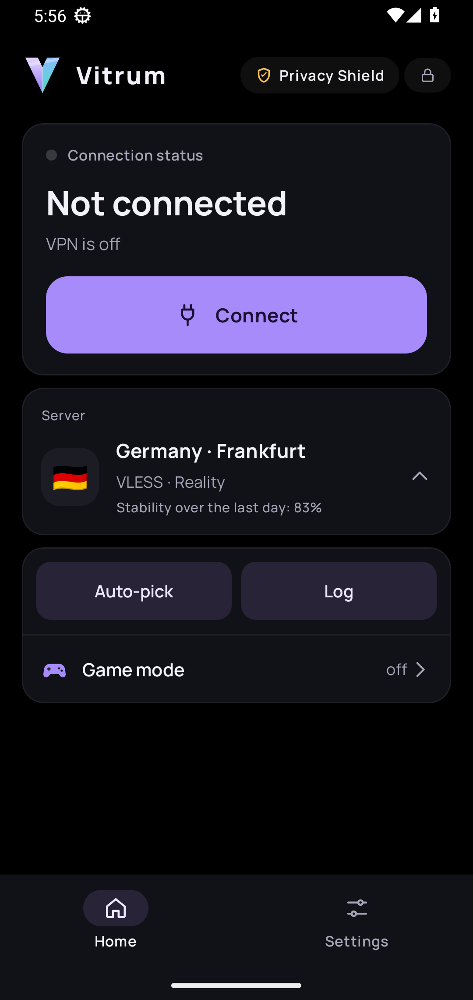
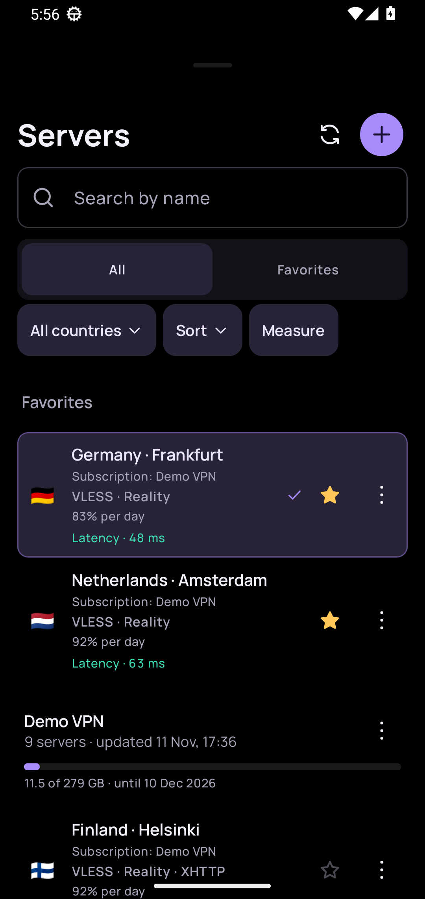
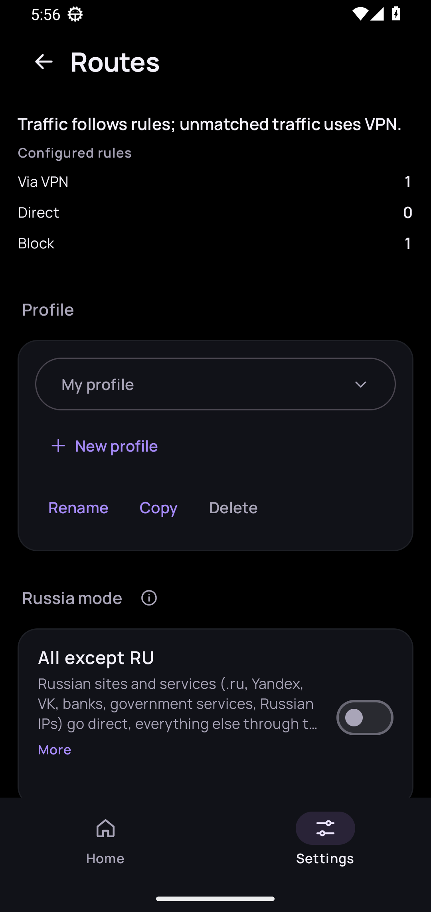
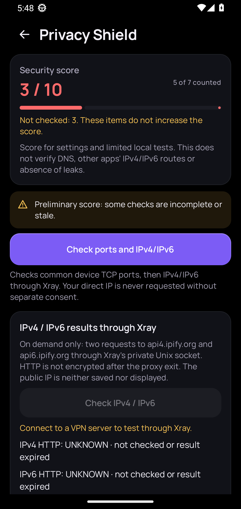
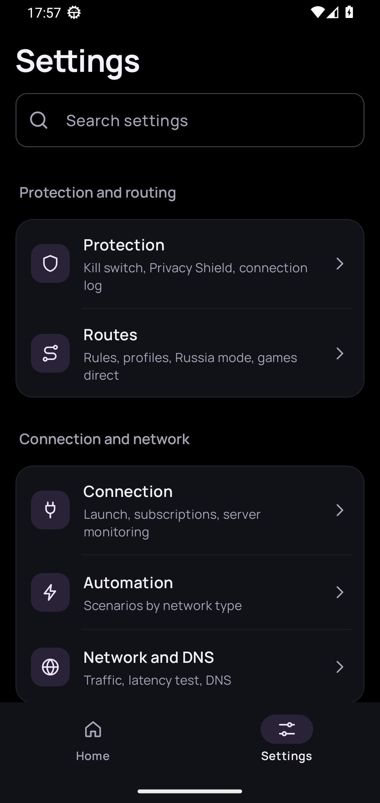
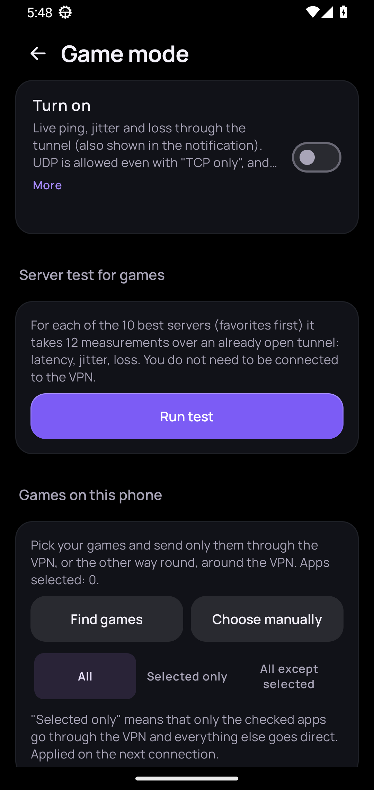

<a href="README.md">English</a> · <a href="https://github.com/lolokeksu09/Vitrum/releases">Релизы</a> · <a href="CONTRIBUTING.md">Участие в разработке</a> · <a href="SUPPORT.md">Поддержка</a> · <a href="GOVERNANCE.md">Управление проектом</a> · <a href="SECURITY.md">Безопасность</a>

  

**Vitrum** — бесплатный VPN-клиент с открытым исходным кодом для Android на базе [Xray-core](https://github.com/XTLS/Xray-core). Импортируйте собственные конфигурации, переключайте серверы, управляйте маршрутизацией приложений и проверяйте сетевые настройки. Без рекламы, аналитики и трекинговых SDK.

**[Скачать Vitrum 2.1.1 (подписанный APK)](https://github.com/lolokeksu09/Vitrum/releases/download/v2.1.1/Vitrum-2.1.1.apk)** · [О релизе](https://github.com/lolokeksu09/Vitrum/releases/tag/v2.1.1) · [English README](README.md)

| Подключение | Управление | Диагностика |
|---|---|---|
| VLESS, VMess, Trojan, Shadowsocks, Hysteria2; импорт ссылок, QR и подписок | Раздельное туннелирование приложений, правила доменов и IP, DNS и переключение серверов | Проверка маршрутов, IPv4/IPv6, DNS и история VPN |

**Совместимость:** Android 8.0+ · ARM64 (`arm64-v8a`) · нужен собственный совместимый сервер, конфигурация или подписка.

**Текущий стабильный релиз:** `v2.1.1` (`versionCode 286`). Исправляет падение WorkManager при запуске проблемной предварительной версии `v2.1.0`. Устанавливайте официальный APK поверх предыдущей версии, не очищая данные. [Причина ошибки и проверки](docs/releases/v2.1.1.md).

**Следующий кандидат:** Vitrum `2.1.2` (`versionCode 287`) в `main` — защита конфиденциальных данных в сообщениях об ошибках подписок и обслуживание репозитория. [Описание изменений](docs/releases/v2.1.2.md). До испытаний официального APK на физическом устройстве это **не стабильный выпуск**. Факт публикации и контрольные суммы проверяйте в [GitHub Releases](https://github.com/lolokeksu09/Vitrum/releases).

## Быстрый старт

1. **Скачайте** официальный `Vitrum-2.1.1.apk` по ссылке выше и установите на совместимый Android. Контрольная сумма и отпечаток подписи указаны в [релизе](https://github.com/lolokeksu09/Vitrum/releases/tag/v2.1.1) и [SECURITY.md](SECURITY.md).
2. **Импортируйте** конфигурацию по ссылке, QR-коду или из подписки. Vitrum — VPN-клиент, а не поставщик серверов или подписок.
3. **Подключитесь**, подтвердив системный запрос Android на создание VPN. При необходимости настройте раздельное туннелирование и DNS.

**Границы проверки:** диагностика разделяет подтверждённые и неизвестные результаты. Тесты сборки и анализ конфигурации не доказывают отсутствие сетевых утечек во всех условиях.

## Скриншоты интерфейса

**Реальные снимки экрана эмулятора Android 13.** Использована отладочная сборка Vitrum и синтетические данные `Demo.kt` (домены `example.com`). VPN-туннель не создавался. Снимки демонстрируют интерфейс, но не являются проверкой сетевой работы официального ARM64 APK.

  
  
  

Главная · Серверы · Маршрутизация

  
  
  

Щит приватности · Настройки · Игровой режим

## Возможности

**VPN и серверы**
- VLESS, VMess, Trojan, Shadowsocks и Hysteria2.
- Транспорты и режимы Xray, поддерживаемые импортированной конфигурацией: Reality, TLS, XHTTP, gRPC, WebSocket и другие.
- Импорт по ссылкам и QR-кодам, HTTPS- и JSON-подписки.
- Поиск серверов, фильтры по странам, сортировка, избранное и проверка задержки.
- Переключение серверов с подтверждением соединения и обработкой отката.
- Автоматический выбор серверов и восстановление при смене сети.

**Маршрутизация**
- Раздельное туннелирование по приложениям и профили маршрутизации.
- Режимы для всего трафика, белого списка и «Все, кроме РФ».
- Пользовательские правила по доменам, IP/CIDR и портам.
- Настройки DNS, DoH, FakeDNS, IPv6 и локальной сети.
- Предварительное объяснение ожидаемого маршрута для приложений, доменов, IP-адресов, портов и протоколов.

**Диагностика**
- «Щит приватности» разделяет подтверждённые результаты, предупреждения и непроверенные проверки.
- Ручные IPv4/IPv6-проверки и анализ DNS-маршрутов.
- Состояние Android Private DNS и ожидаемая маршрутизация DoT/DoQ.
- История событий VPN и диагностические отчёты.
- Диагностика различает анализ конфигурации и наблюдаемые результаты. Она не является универсальной гарантией того, что трафик никогда не обойдёт VPN.

**Повседневное использование**
- Игровой режим и исключения приложений для выбранных игровых платформ.
- Статистика трафика, плитка быстрых настроек и ярлык подключения.
- Зашифрованные резервные копии .vitrumbak, блокировка приложения и виджет.
- Русский и английский интерфейс, поддержка увеличенного шрифта и TalkBack.

Актуальные изменения: [кандидат 2.1.2](docs/releases/v2.1.2.md), [стабильный релиз 2.1.1](docs/releases/v2.1.1.md) и [CHANGELOG.md](CHANGELOG.md). Предыдущий крупный выпуск: [Vitrum 2.0.0](docs/releases/v2.0.0.md).

## Загрузка

Скачивайте APK только со страницы [GitHub Releases](https://github.com/lolokeksu09/Vitrum/releases).

| Выпуск | Application ID | Android | Архитектура |
|---|---|---:|---|
| **[Vitrum 2.1.1 — стабильный](https://github.com/lolokeksu09/Vitrum/releases/tag/v2.1.1)** | **app.rayclient** | **8.0+** | **ARM64** |
| [Vitrum 2.0.0](https://github.com/lolokeksu09/Vitrum/releases/tag/v2.0.0) | app.rayclient | 8.0+ | ARM64 |
| [Vitrum 1.0.0](https://github.com/lolokeksu09/Vitrum/releases/tag/v1.0.0) | app.rayclient | 8.0+ | ARM64 |
| [Vitrum Lite 1.0.0](https://github.com/lolokeksu09/Vitrum/releases/tag/lite-v1.0.0) | app.rayclient.lite | 6.0+ | ARMv7 |

Vitrum Lite — отдельная упрощённая сборка. Она не заменяет и не обновляет основное приложение.

## Совместимость

| Компонент | Текущая конфигурация |
|---|---|
| Основное приложение | Android 8.0 (API 26) и новее |
| Основная ABI | arm64-v8a |
| Application ID основного приложения | app.rayclient |
| Application ID Lite | app.rayclient.lite |
| Android compile SDK | 37.0 |
| Kotlin/JVM target | 17 |
| JDK для сборки | 21 |
| Лицензия | GNU GPL v3.0 |

## Сборка из исходников

Требования: Linux или WSL, JDK 21, Android SDK Platform 37.0, Build Tools 37.0.0 и доступ в интернет для загрузки проверенных runtime-ресурсов Xray.

Из корня репозитория:

~~~bash
tools/SETUP_ENV.sh
tools/FETCH_BINARIES.sh --linux
tools/build.sh debug
~~~

Скрипт сборки работает в фоне и сохраняет логи в /tmp/vitrum-build/. Проверить ход сборки:

~~~bash
tail -n 30 /tmp/vitrum-build/debug.log
cat /tmp/vitrum-build/done
~~~

Запуск настроенных unit-тестов и Android compilation checks:

~~~bash
tools/build.sh tests
~~~

Для подписанного release APK нужен авторский keystore keystore/vitrum-release.jks и переменная VITRUM_KS_PASS. Keystore и пароль в репозитории не хранятся. Не создавайте другой ключ и не выдавайте подписанный им APK за официальное обновление.

## Структура проекта

| Путь | Назначение |
|---|---|
| app/ | Основное Android-приложение |
| lite/ | Упрощённое ARMv7-приложение |
| tools/ | Подготовка среды, загрузка runtime-ресурсов и сборочные скрипты |
| .github/workflows/ | Сборка, PR и автоматизация Lite |
| docs/ | Handoff и техническая документация |
| docs/releases/ | Заметки выпусков и исторический архив |
| AGENTS.md | Правила разработки и безопасности |
| SECURITY.md | Сообщение об уязвимостях и проверка подписи релиза |
| CODE_OF_CONDUCT.md | Правила поведения в сообществе |
| SUPPORT.md | Область поддержки и диагностика проблем |
| GOVERNANCE.md | Роли сопровождающего и принятие решений |
| docs/ARCHITECTURE.md | Границы и компоненты архитектуры |
| docs/TESTING.md | Покрытие CI и границы ручных проверок |
| docs/RELEASING.md | Версионирование, подпись и публикация |

В основном Gradle-проекте также есть внутренняя build variant clone, используемая CI. Это не отдельный публичный продукт или релиз.

## Приватность и безопасность

- В приложении нет рекламных, аналитических и трекинговых SDK.
- Данные серверов и подписок хранятся с использованием механизмов шифрования приложения.
- Обновления и подписки используют HTTPS.
- Диагностические отчёты не должны содержать ключи серверов, URL подписок и исходную Xray-конфигурацию.
- Предварительный просмотр маршрутов и проверки приватности имеют ограничения. Их нельзя трактовать как доказательство отсутствия утечек на любом Android-устройстве, в любом приложении, сетевом окружении и режиме маршрутизации.

Перед сообщением об уязвимости прочитайте [SECURITY.md](SECURITY.md). Не публикуйте эксплуатируемые детали в открытых Issues.

## Управление проектом и инженерные процессы

- [Правила сообщества](CODE_OF_CONDUCT.md)
- [Политика поддержки](SUPPORT.md)
- [Управление проектом](GOVERNANCE.md)
- [Архитектура](docs/ARCHITECTURE.md)
- [Тестирование](docs/TESTING.md)
- [Процесс выпуска](docs/RELEASING.md)

## Участие в разработке

Приветствуются точечные исправления ошибок, улучшения документации и доступности, а также исправления переводов.

1. Перед созданием Issue проверьте, нет ли похожего обсуждения.
2. Для крупных изменений сначала откройте Issue и согласуйте объём.
3. Прочитайте [CONTRIBUTING.md](CONTRIBUTING.md) и [AGENTS.md](AGENTS.md).
4. Делайте pull request узким по объёму и описывайте влияние на пользователя.
5. Не добавляйте ключи подписи, пароли, URL подписок, реальные ссылки серверов и персональные данные.

Перед слиянием pull request проходит проверку сопровождающего проекта. Успешный CI не заменяет review и проверку на физическом устройстве для VPN- и сетевого поведения.

## Лицензия

Vitrum распространяется по лицензии [GNU General Public License v3.0](LICENSE). Сторонние компоненты перечислены в [THIRD-PARTY-NOTICES.txt](THIRD-PARTY-NOTICES.txt).
