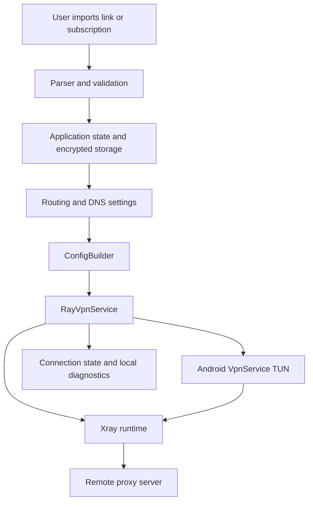

# Architecture

This document describes the repository architecture at a component level. It is not a promise that every networking behaviour is identical on all Android versions or devices.

## Modules and platforms

| Module | Implementation | Minimum Android | ABI | Role |
|---|---|---:|---|---|
| `:app` | Kotlin, Jetpack Compose, Android APIs and native Xray runtime | API 26 (Android 8.0) | `arm64-v8a` | Main Vitrum VPN client |
| `:lite` | Java and standard Android Views with a separately built native runtime | API 23 (Android 6.0) | `armeabi-v7a` | Independent reduced Lite application |

The main package ID is `app.rayclient`; Lite uses `app.rayclient.lite`. They are separate Android packages. The main Gradle module also defines an internal `clone` build type for CI and isolated testing; it is not a third public product or release.

The root Gradle project is still named `RayClient`. This is an internal project name and does not change the public Vitrum product name or Android package IDs.

## Main application

The main application is organised around these responsibilities:

- **Entry and UI:** `MainActivity` initializes app state, handles Android intents and hosts the Compose UI.
- **Application state:** `AppState` and related state holders coordinate settings, profiles, servers, subscriptions and screen state.
- **VPN lifecycle:** `RayVpnService` extends Android `VpnService`, owns the TUN lifecycle and coordinates start, stop, switching and recovery.
- **Xray configuration:** `ConfigBuilder` translates application routing and DNS settings into Xray configuration.
- **Protocol import:** `Links` parses supported share-link schemes into internal server configuration. Subscription parsing and fetching are separate paths.
- **Secret storage:** `Vault` uses Android Keystore-backed AES-GCM encryption for stored server/subscription data. If the key is unavailable or data cannot be decrypted, the application must not silently replace the existing stored data with an empty value.
- **Native runtime:** native launch support and the Xray runtime are packaged for the main ARM64 ABI. Runtime assets are retrieved and verified by `tools/FETCH_BINARIES.sh` during development/CI preparation.

These boundaries describe responsibilities, not a guarantee that every action is performed synchronously or in one process.

## High-level connection flow

The diagram is conceptual. It does not specify every internal thread, socket or error transition.

## Network and security boundaries

- Android `VpnService` establishes the TUN interface. The application itself is excluded from its own VPN to avoid a recursive tunnel.
- Xray is the proxy engine. Vitrum creates its configuration from selected servers, subscriptions and routing settings; it does not replace Xray with another proxy core.
- Server credentials and subscription data must not be committed, printed in logs or included in public diagnostic reports.
- Stored secrets use the application storage mechanisms and Android Keystore. Temporary runtime configuration containing credentials must remain in the application's private storage and be cleaned up according to the existing lifecycle.
- No root access, advertising SDK, analytics or tracking service is part of the supported architecture.
- The internal Clone build type uses a separate application suffix and is intended for testing; its signing identity is not the official release identity.

## Diagnostics are not network guarantees

A route preview explains the configured rule order. A local DNS audit explains an expected route. A request through an Xray diagnostic socket demonstrates only that diagnostic path. None of these alone proves that every application packet, DNS request or IP family traverses the VPN on every Android device.

Excluded applications, Android Private DNS, application-level DoH, user routing rules, firmware behaviour and network transitions require separate analysis and, where relevant, physical-device testing. See [TESTING.md](TESTING.md) and [docs/ANDROID_RUNTIME_CHECKS.md](ANDROID_RUNTIME_CHECKS.md).

## Build and version sources

- Main app version and package/ABI settings: `app/build.gradle.kts`.
- Lite version and package/ABI settings: `lite/build.gradle.kts`.
- Xray version declaration: `app/src/main/java/app/rayclient/Brand.kt` and `tools/FETCH_BINARIES.sh`.
- Build entry points: `tools/SETUP_ENV.sh`, `tools/FETCH_BINARIES.sh`, `tools/build.sh` and `tools/build-lite-arm32.sh`.

For the current public release and repository state, use [HANDOFF.md](HANDOFF.md) and [release notes](releases/README.md).
