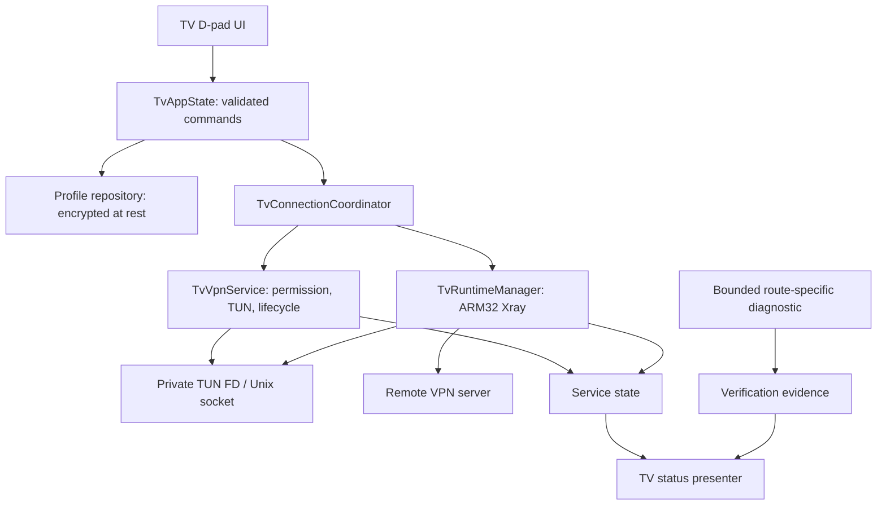

# Vitrum TV — architecture proposal

**Status:** design decision proposal. `:tv` and its package ID are **not present** in source. No VPN implementation has been created or tested.

## 1. Module and product boundary

Recommended initial structure (paths below are proposed new paths, not current files):

```text
:tv/
  build.gradle.kts
  src/main/AndroidManifest.xml
  src/main/java/app/rayclient/tv/
    TvActivity.kt             # TV navigation / focus only
    TvAppState.kt             # UI state and commands
    TvVpnService.kt           # Android VpnService and foreground lifecycle
    TvConnectionCoordinator.kt
    TvXrayConfig.kt
    TvRuntimeManager.kt       # Xray process, TUN FD, cleanup
    TvProfileStore.kt         # Android Keystore-backed encrypted secrets
    TvSubscriptionRepository.kt
    TvSplitPolicy.kt
    TvConnectionEvidence.kt
  src/main/res/
    drawable/ ...             # TV launcher assets
    values/strings.xml
    drawable-nodpi/ ...       # TV banner
  src/test/ ...
  src/androidTest/ ...
docs/tv/                      # design, security and verification contracts
```

**Product independence:** no Gradle project dependency from `:tv` to `:app` or `:lite`. Do not migrate, import, copy or alias the other products' private data, signing keys or shared preferences. Any future truly shared, platform-neutral parser may be extracted only after a separate ADR, compatibility proof, license check and review. No dependency extraction in the foundation stage.

**Suggested package ID (not yet approved):** `app.rayclient.tv`. A distinct package avoids overwriting an existing Android application. Define a dedicated TV signing and update lineage before the first distributable APK. Do **not** call a random debug certificate an official update.

## 2. Language and TV UI

Candidate: Kotlin and Compose for TV, with explicit focus traversal and input instrumentation. This provides a native TV presentation rather than scaling the phone screens. The exact TV Compose artifact/API and compiler compatibility require a dependency/build spike on this repository's Android toolchain. If memory or focus behavior fails on 2 GB hardware, evaluate plain Android Views as an **alternative architecture decision**, not as a silent pivot.

- D-pad Up/Down/Left/Right, Center/OK and system Back are mandatory.
- Focus is explicit, recoverable after permission dialogs and stable after list updates.
- Animations are brief, finite and optional. No continuously running ambient effects.
- UI never performs network work or manages native process lifetime directly.

## 3. Native VPN engine

Target `armeabi-v7a` (32-bit); build an **independent** Android-compatible Xray-core binary and native launch/TUN interop. Existing ARM64 `:app` artifacts cannot be used on a device exposing only 32-bit application ABI. The exact Xray version, compiler/toolchain, process-start strategy and ELF/JNI layout are subject to a verified build spike.

Critical boundaries:
- `TvVpnService` obtains Android `VpnService.prepare` permission and owns TUN establishment, service lifecycle and revocation.
- `TvRuntimeManager` starts and stops an actual compatible ARM32 Xray runtime with bounded timeouts, PID ownership and native-process cleanup.
- VPN packet ingress uses **app-private Unix-domain sockets and file descriptors**; no unauthenticated TCP listener (including loopback) may be introduced as a shortcut.
- VPN client's own sockets must be protected against recursive tunneling with Android `VpnService.protect` / appropriate process exclusions.
- Config and server secrets must be encrypted at rest, held only as needed in memory, and removed from temporary files after teardown. The service must never log raw config, links or subscription URLs.
- STOP/START, server switch, onRevoke, crash, force stop, network change and process death must have explicit state transitions and recovery/cleanup rules. A dead core must **not** leave the UI displaying working VPN.
- Implement IPv4/IPv6/DNS behavior only after examining actual TUN routes, Android networking APIs and Xray configuration. Do not silently route forbidden traffic through `direct`.

## 4. Android TV integration

Target-first API 30; compatibility floor is **TBD after hardware and manifest testing**. TV manifest must use:
- A dedicated TV launcher activity with `android.intent.category.LEANBACK_LAUNCHER`.
- `android.hardware.touchscreen` with `required=false`.
- TV banner/icon assets, documented landscape and overscan-safe presentation.
- `VpnService` declared with `android.permission.BIND_VPN_SERVICE` and the `android.net.VpnService` action.
- Foreground notifications and modern permission/background execution rules appropriate to the chosen targetSdk (verify against actual target and supported Android releases).
- `android:allowBackup="false"` and `android:usesCleartextTraffic="false"`.

**Always-on:** prefer the system-provided Always-on VPN setting and state API when firmware exposes them. Do not claim that an app-side BOOT_COMPLETED receiver guarantees automatic VPN startup on all TV firmware. Lockdown behavior and user-selected per-app bypass semantics require separate physical tests.

## 5. Control and state diagram



The diagram is conceptual, not a claim of any running path today.

## 6. Separate evidence layers

1. **Configuration loaded:** parser accepted format; no network evidence.
2. **Native process active:** the core started; still no tunneled traffic evidence.
3. **TUN established:** Android granted interface; routing still unproven.
4. **Observed test route:** a selected diagnostic passed through a measured route.
5. **Leak testing:** independent DNS/IPv4/IPv6, transitions, bypass and lockdown scenarios with device evidence.

UI must disclose missing checks as UNKNOWN, never promote layer 2 or 3 to layer 5.

## 7. Non-negotiable implementation gates

- Commit no credentials, real endpoints, keystores, test accounts or private panel traffic.
- APK ABI, manifest, signature and background behavior verified **on BOXY** before claiming compatibility.
- Native Xray build and routing validation precede all UI claims of functional VPN.
- No changes to existing `:app` / `:lite` behavior, versions, release workflows or assets without a separate authorization and PR.

## Sources

[Android TV application guidance](https://developer.android.com/training/tv/get-started/create) ·
[TV D-pad navigation](https://developer.android.com/training/tv/get-started/navigation) ·
[Android VpnService lifecycle](https://developer.android.com/develop/connectivity/vpn) ·
[Android VpnService API](https://developer.android.com/reference/android/net/VpnService).
